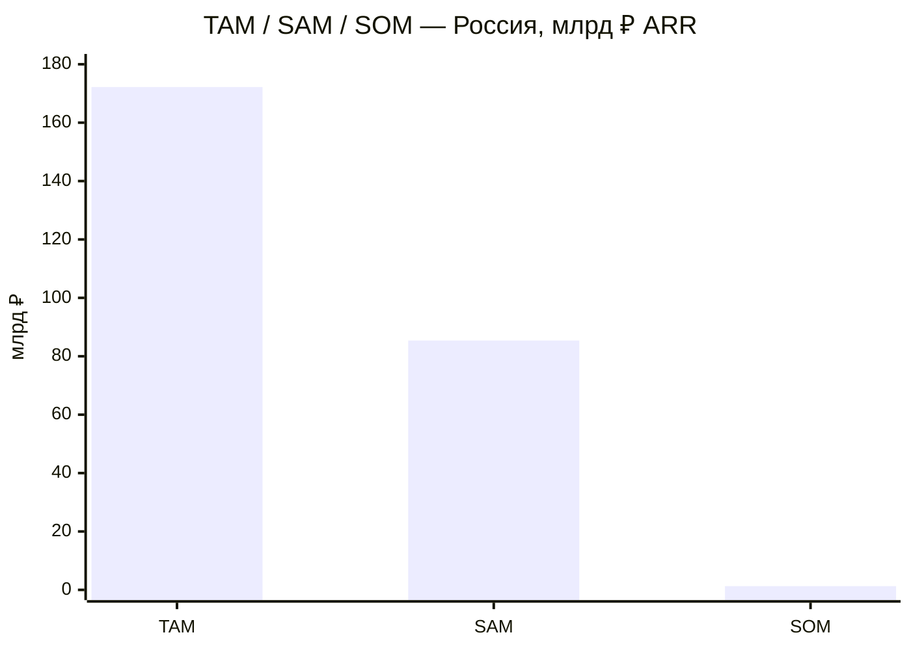
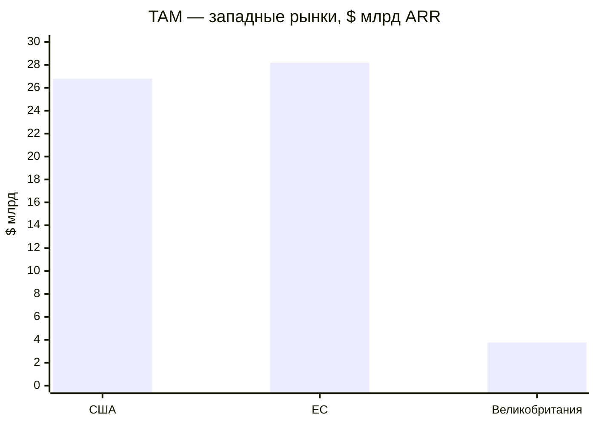
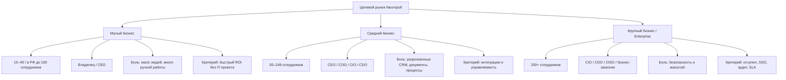
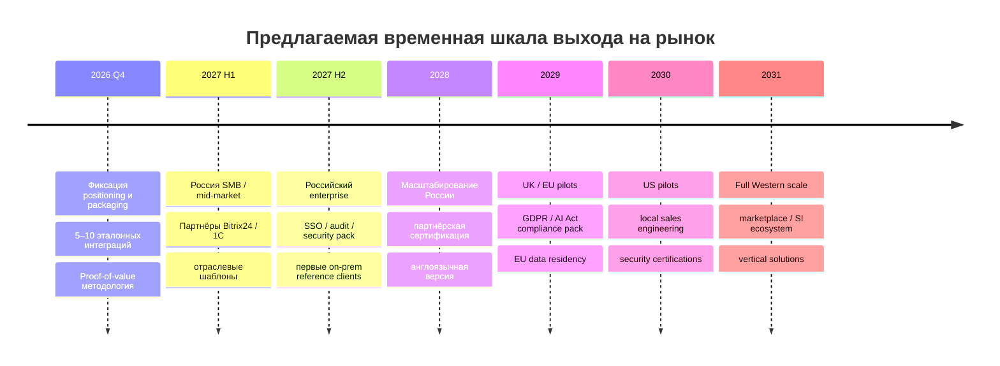

# Аналитический отчёт по рынку продукта «Нейропульт» / Neuropult

## Суть продукта и исполнительное резюме

По приложенному описанию **Нейропульт — это корпоративный AI-контур для бизнеса, то есть единый AI-слой поверх существующей IT-инфраструктуры компании**. Он не задуман как замена CRM, 1С, CMS или таск-трекерам: его функция — подключаться к ним, к файлам, базам знаний, репозиториям, серверам, сайтам, мессенджерам и внешним API и позволять сотруднику ставить задачи обычным языком — текстом или голосом. Внутри этой среды работают AI-сотрудники, агенты, skills, сценарии и инструменты, способные выполнять не только информационные запросы, но и действия: работать с CRM, создавать и сопровождать сайты и ботов, генерировать контент, документы и презентации, заниматься SEO/SMM, аналитикой, кодом и инфраструктурой. fileciteturn0file0

Ключевое позиционирование из файла — **«AI-контур для бизнеса»**. Продукт имеет две модели поставки: managed cloud с отдельным контуром клиента вида `{client}.neuropult.ru` и on-premise в инфраструктуре заказчика. В облаке предусмотрены три тарифа: 20 тыс., 100 тыс. и 200 тыс. ₽ в месяц; при годовой оплате — соответственно 200 тыс., 1 млн и 2 млн ₽ в год. Все функции доступны на любом тарифе, различается в первую очередь объём AI-ресурса. On-premise-линейка стоит 1,95 млн, 4,95 млн и от 9,95 млн ₽ в год; старшие уровни добавляют SSO/LDAP, аудит, HA, резервирование, PROD/TEST, повышенный SLA и несколько независимых контуров. fileciteturn0file0

Противоречий внутри предоставленного файла по базовой архитектуре и актуальной тарифной сетке нет: документ прямо утверждает, что приведённые цены заменяют все предыдущие варианты. Есть лишь **неопределённость по лимитам пользователей в облачных тарифах** — файл специально указывает, что они пока не определены. fileciteturn0file0

Главный вывод исследования: **рыночная ниша для Neuropult существует, но наиболее сильной будет не позиция “ещё один корпоративный чат-бот”, а позиция “операционная AI-платформа, которая выполняет работу поверх уже существующих систем”**. Российский рынок особенно благоприятен для on-prem/private-cloud версии из-за требований к локализации данных, ограниченного выбора западных enterprise AI-платформ и сильного спроса на интеграции с 1С, Bitrix24 и локальными коммуникационными каналами. В России прямыми ориентирами выступают Just AI Agent Platform, BitrixGPT, Naumen Erudite, MTS AI Cotype/MWS AI и Cloud.ru AI Agents; на Западе — OpenAI, Microsoft, Google, Salesforce, UiPath, Glean и Writer. citeturn960023search2turn939574search1turn960023search0turn939574search7turn643879search8

Расчётный **TAM для России составляет около 172 млрд ₽ годового контрактного рынка**, а реалистически адресуемый SAM — порядка **85 млрд ₽**. Для США модель даёт TAM порядка **$26,8 млрд**, для ЕС — **$28,2 млрд**, для Великобритании — **$3,8 млрд**. Эти цифры не являются оценкой существующего “рынка Neuropult” от исследовательского агентства; это bottom-up модель, построенная на числе компаний соответствующего размера и типовом годовом контракте на AI/automation platform. Методика и чувствительность приведены ниже.

На пятилетнем горизонте реалистичный сценарий предполагает порядка **395 млн ₽ ARR в России** плюс **$5,1 млн ARR на западных рынках**. При официальном курсе Банка России на 7 ноября 2026 года $1 = 82,1386 ₽ это эквивалентно примерно **814 млн ₽ совокупного ARR**. Агрессивный сценарий может вывести бизнес примерно к **2,2 млрд ₽ эквивалентного ARR**, но только при создании партнёрского канала, шаблонных отраслевых решений и полноценного enterprise-security стека. Курс на дату исследования — 82,1386 ₽/$; именно он используется для сравнительных пересчётов. citeturn862587search0turn862587search1

## Конкурентное поле и цены

Рынок разделён как минимум на четыре конкурентных класса. Первый — универсальные AI-workspace и copilot-продукты, например ChatGPT Business, Microsoft 365 Copilot и Gemini Enterprise. Второй — платформы для агентной автоматизации: Salesforce Agentforce, UiPath, Just AI, Cloud.ru. Третий — корпоративный search/knowledge/agent слой вроде Glean и Writer. Четвёртый — AI как функция внутри уже установленной бизнес-системы, наиболее яркий российский пример — BitrixGPT. Для Neuropult опаснее всего не отдельный продукт, а комбинация “корпоративный AI + ecosystem lock-in”: Microsoft внутри M365, Salesforce внутри CRM, BitrixGPT внутри Bitrix24. citeturn963734search4turn963734search7turn939574search8

| Рынок / компания | Продукт | Ключевые функции | Модель цены и публичная цена | Отношение к Neuropult |
|---|---|---|---|---|
| Россия — Bitrix24 | BitrixGPT | AI в CRM, задачах, почте, сайтах, расшифровке звонков, генерации текста | Bitrix24: от 1 990 ₽/мес. при годовой оплате за Basic; Professional 11 190 ₽/мес.; Enterprise от 27 190 ₽/мес. BitrixGPT/Marketplace продаётся как доп. подписка; например 500 ₽/мес. по акции для Basic, 1 500 ₽ для Standard, 3 000 ₽ для Professional | Сильный конкурент там, где Bitrix24 уже является центром операционной деятельности; слабее как нейтральный слой над разными системами. citeturn939574search1turn939574search8 |
| Россия — Just AI | Agent Platform | no-code/low-code агенты, процессы, RAG, интеграции, cloud и on-prem | Cloud: 1 990 ₽ Start, 4 990 ₽ Solo, 9 990 ₽ Team, 24 490 ₽ Department; Enterprise Cloud — от 100 000 ₽/мес.; on-prem — индивидуально | Один из наиболее прямых конкурентов по агентной платформе и enterprise placement. citeturn960023search3turn960023search2 |
| Россия — Naumen | Erudite | AI-ассистенты и автономные AI-агенты, контакт-центры, no-code, API и коннекторы | Цена рассчитывается индивидуально | Сильнее в customer service/contact center; уже по горизонтали бизнес-функций, чем Neuropult. citeturn960023search0 |
| Россия — MTS AI | Cotype / GenAI solutions | корпоративная генеративная AI-платформа и модули, поставка enterprise | лицензия от **6,4 млн ₽**, без НДС; поддержка и модули рассчитываются индивидуально | Премиальный enterprise benchmark; создаёт “ценовой потолок”, относительно которого Neuropult on-prem выглядит доступным. citeturn939574search7 |
| Россия — Cloud.ru | AI Agents / Agents Space | агентные системы, MCP, модели, compute, RAG и cloud infrastructure | PAYG: выделенный 1 vCPU 1,5616 ₽/ч с НДС, 1 ГБ RAM 0,3904 ₽/ч; базовый Agents Space 2 vCPU/4 ГБ — 3,84 ₽/ч плюс токены моделей | Инфраструктурный конкурент: дешевле как сырьё, но клиенту самому надо строить solution layer. citeturn960023search4turn960023search5turn960023search6 |
| Россия — Yandex Cloud | AI Studio | модели, embeddings, AI-агенты, инструменты, agent builder | consumption pricing; AI Studio тарифицируется по используемым сервисам/ресурсам | Конкурент как технологическая платформа, но не готовый единый операционный интерфейс для бизнеса. citeturn939574search2turn939574search3 |
| Россия — GigaChat | GigaChat API / On-Prem | LLM API, корпоративные сценарии, cloud и on-prem модели | cloud/token usage; on-prem цена по запросу | Скорее модельный/infrastructure layer, который Neuropult потенциально может использовать как провайдера. citeturn939574search6 |
| Запад — OpenAI | ChatGPT Business / Enterprise | корпоративный чат, agents, Work, Codex, company knowledge, connectors, admin/SSO | Business Standard: **$20/user/month annual или $25 monthly**; Premium: **$100 annual / $125 monthly**; Enterprise — custom | Очень сильный horizontal competitor, особенно для knowledge work; меньше ориентирован на российские ERP/CRM и локальный on-prem. citeturn963734search0turn963734search2 |
| Запад — Microsoft | Microsoft 365 Copilot | AI в Word, Excel, PowerPoint, Outlook, Teams; agents через Copilot Studio | Microsoft 365 Copilot — около **€26/user/month** при годовой оплате в европейском прайсе; нужен подходящий M365-план | Главный конкурент в компаниях, глубоко сидящих на Microsoft stack. citeturn963734search5 |
| Запад — Google | Gemini Enterprise | enterprise search, assistant, agents, connectors, Google ecosystem | Business edition **от $21/seat/month**; Standard/Plus — enterprise sales; возможен PAYG поверх квот | Сильный аналог “AI layer”, особенно для Google Workspace/Google Cloud клиентов. citeturn646524search15turn646524search3turn646524search2 |
| Запад — Salesforce | Agentforce | автономные agents, actions, CRM workflows, customer service | $5/user/month Agentforce license + Flex Credits; $125/user/month flat employee add-on; $500 за 100k Flex Credits; $2/conversation также доступно | Крайне сильный в CRM-centric use cases и enterprise workflow. citeturn963734search7turn963734search8 |
| Запад — UiPath | Agentic Automation | agents + robots + orchestration + human-in-the-loop + document automation | Basic от **$25/month**; Standard/Enterprise — по запросу; usage через Platform Units | Сильнейший конкурент там, где автоматизация требует RPA и детерминированных процессов. citeturn643879search8turn643879search9 |
| Запад — WRITER | WRITER Agent | chat, playbooks, routines, orchestration, knowledge graph, governance | Starter — seat/credits, цена в публичной выдаче не раскрывается; Enterprise — contact sales | Близок по концепции enterprise agent workspace; особенно силён в governance и knowledge workflows. citeturn643879search7 |
| Запад — Glean | Assistant / Agents | enterprise search, knowledge grounding, execution across connected apps, agents | Enterprise Flex на credits; публичного фиксированного enterprise прайса нет | Особенно опасен в крупных западных компаниях как “AI layer over company knowledge”. citeturn643879search5turn643879search6 |

Главное ценовое наблюдение: **облачный Neuropult “Старт” за 200 тыс. ₽/год ≈ $2,4 тыс./год** при текущем курсе, а “Стандарт” ≈ $12,2 тыс./год, “Максимум” ≈ $24,3 тыс./год. Это заметно отличается от seat-based модели западных продуктов. Например, 50 стандартных ChatGPT Business seats при годовой оплате дают $12 тыс./год, а 100 — $24 тыс./год. Таким образом, облачный Neuropult “Стандарт” примерно соответствует по цене 50 ChatGPT Business seats, но продаёт не отдельные рабочие места, а целый контур с интеграциями и AI-ресурсом. fileciteturn0file0 citeturn963734search0turn862587search0

Это создаёт хорошую основу для ценового аргумента: **“цена не за каждого пользователя, а за работающий AI-контур компании”**. Одновременно текущая сетка Neuropult слишком резко прыгает с 20 тыс. до 100 тыс. ₽/мес., а затем до 200 тыс. ₽/мес. Для SMB такой скачок создаёт риск “ценового обрыва”; ниже предлагается более управляемая упаковка без изменения базовой продуктовой логики.

## Размер рынка, TAM / SAM / SOM и сегментация

Для оценки используется bottom-up подход. Он лучше внешней оценки рынка “AI software” в миллиардах долларов, поскольку Neuropult продаётся **компаниям**, и объём можно связать с количеством потенциальных покупателей и разумным annual contract value.

В России на 10 июля 2026 года ФНС насчитывала **6,612 млн субъектов МСП**, из них более 6,3 млн — микропредприятия, более 241 тыс. — малые и чуть более 24 тыс. — средние. ФНС определяет микропредприятия как организации до 15 сотрудников, малые — до 100, средние — до 250, при этом применяются также пороги дохода. citeturn136645search0turn136645search2turn736496search2

Микробизнес сознательно исключён из основного TAM: при цене Neuropult от 200 тыс. ₽/год большинство компаний с 0–15 сотрудниками не являются экономически естественной аудиторией. Малые предприятия ФНС используются как российский сегмент “small”, средние — “medium”. Для крупных компаний в модели используется **рабочая оценка 20 тыс. организаций**; это не официальная статистика ФНС и является наиболее чувствительным допущением российской модели.

В ЕС Eurostat сообщает о примерно 34 млн предприятий бизнес-экономики в 2024 году; около 0,8% относятся к предприятиям с 50–249 занятыми и 0,2% — к крупным. В 2023 году структура составляла 94,3% micro, 4,8% small 10–49, 0,8% medium и 0,2% large; для расчёта 2024 года применяется эта стабильная структура, что даёт приблизительно 1,63 млн small, 272 тыс. medium и 68 тыс. large. citeturn372098search0turn372098search8

В Великобритании свежая официальная оценка 2026 года даёт **225 215 компаний с 10–49 сотрудниками, 39 220 с 50–249 и 8 355 с 250+**. citeturn745893search0turn745893search20

Для США используются Census employer establishments как приближение по размеру: 1 047 307 организаций/точек с 10–19 занятыми и 759 342 с 20–49; 249 344 с 50–99, 138 356 с 100–249 и 38 279 с 250–499. Для крупного бизнеса более корректной контрольной величиной является оценка SBA: **21 041 large businesses**, поэтому именно она используется для large-сегмента. SBA также оценивает число employer small businesses в 6,396 млн. citeturn180537search8turn736496search8

В базовой модели используются следующие **не рыночные факты, а аналитические ACV-допущения**:

| Сегмент | Россия: модельный ACV | Запад: модельный ACV | Почему |
|---|---:|---:|---|
| Малый | 200 тыс. ₽/год | $6 тыс./год | 1–2 простых AI-сценария, managed cloud, небольшой объём AI |
| Средний | 1 млн ₽/год | $30 тыс./год | несколько отделов, CRM/ERP, knowledge base, регулярные автоматизации |
| Крупный | 5 млн ₽/год | $150 тыс./год | on-prem/private cloud, SSO, audit, HA, интеграции, SLA |

Эти допущения согласуются с собственной тарифной сеткой Neuropult: 200 тыс.–2 млн ₽/год cloud и 1,95–9,95+ млн ₽/год on-prem. Они также находятся в диапазоне публичных цен конкурентов: Just AI Enterprise начинается от 100 тыс. ₽/мес., MTS AI Cotype — от 6,4 млн ₽ за лицензию, Salesforce Agentforce — до $125 на пользователя в месяц, а OpenAI Business — $20–100 на seat в месяц при годовой оплате. fileciteturn0file0 citeturn960023search2turn939574search7turn963734search7turn963734search0

**TAM** = число потенциальных компаний × модельный ACV. **SAM** дополнительно ограничивается цифровой готовностью и вероятностью покупки такого класса решений: 20% малых, 45% средних, 65% крупных. **SOM** — целевой достижимый ARR через пять лет; для России заложено 1,5% SAM, для каждого западного рынка — 0,5%, поскольку у нового бренда на Западе выше стоимость выхода и сильнее incumbents.

| Рынок | TAM | SAM | Модельный 5-летний SOM |
|---|---:|---:|---:|
| Россия | **172,2 млрд ₽/год** | **85,4 млрд ₽/год** | **1,28 млрд ₽ ARR** |
| США | **$26,8 млрд/год** | **$10,0 млрд/год** | **$49,9 млн ARR** |
| ЕС | **$28,2 млрд/год** | **$12,3 млрд/год** | **$61,3 млн ARR** |
| Великобритания | **$3,78 млрд/год** | **$1,61 млрд/год** | **$8,1 млн ARR** |

Эти значения лучше воспринимать как **размер экономически возможного поля**, а не прогноз продаж. Например, SOM $50 млн в США не означает, что Neuropult автоматически способен его получить: это лишь 0,5% расчётного SAM и требует американской/европейской юридической структуры, локального sales engineering, security certification, data residency и десятков готовых enterprise connectors.

### Сегменты, бюджеты и покупательские роли

Для **малого бизнеса** целевой бюджет Neuropult разумно рассматривать в диапазоне 15–50 тыс. ₽ в месяц в России и $300–1 000 в месяц на Западе. Покупатель — собственник, CEO или руководитель продаж/маркетинга. Главные боли: недостаток сотрудников, ручная работа, копирование данных между CRM, сайтом, мессенджерами и документами. Для них нельзя продавать “платформу AI-агентов”: эффективнее оффер “один AI-сотрудник закрывает X повторяющихся процессов”.

Для **среднего бизнеса** типичный плановый бюджет должен быть примерно 0,6–3 млн ₽ в год в России или $15–60 тыс. в год на Западе. Решение уже принимает группа: CEO/COO как экономический покупатель, CIO/CDO как архитектурный владелец, IT и руководитель конкретной функции как инициаторы. Ключевой критерий — не качество чата, а интеграция с CRM/ERP/knowledge base, возможность делегировать действия, логирование и понятный ROI.

Для **enterprise** разумный диапазон проекта — примерно 3–15+ млн ₽ в год в России и $75–300+ тыс. на Западе. Здесь закупка почти всегда мультистейкхолдерная: CIO/CDO, CISO, procurement/legal, DPO, бизнес-заказчик и архитекторы. Критерии: on-prem/private cloud, SSO/LDAP/SCIM, RBAC, audit trails, segregation of duties, observability, SLA, DR/HA, модели собственной инфраструктуры, vendor risk и data residency.

С точки зрения численности сегментов Neuropult имеет интересную асимметрию: количество малых компаний огромно, но enterprise-компания создаёт в десятки раз больше выручки. В ЕС, например, крупные компании составляют лишь около 0,2% предприятий, но создают около 49% value added; medium — около 0,8% компаний и 16% value added. Поэтому для Neuropult рациональная стратегия — **не строить классический SMB SaaS с миллионами self-service клиентов, а использовать SMB как продуктовый funnel, а основную валовую прибыль получать от medium/enterprise**. citeturn372098search0turn372098search7

## Прогноз продаж и сценарии

Прогноз ниже строится как sales-capacity model, а не экстраполяция общего TAM. Предполагается, что Россия является первым рынком, а западная экспансия начинается после формирования repeatable product-market fit, англоязычной версии, security pack и партнёрской модели.

### Россия

| Сценарий | Год | Малые клиенты | Средние | Крупные | ARR |
|---|---:|---:|---:|---:|---:|
| Консервативный | 1 | 10 | 4 | 1 | **11 млн ₽** |
|  | 3 | 50 | 15 | 4 | **45 млн ₽** |
|  | 5 | 180 | 50 | 12 | **146 млн ₽** |
| Реалистичный | 1 | 20 | 8 | 3 | **27 млн ₽** |
|  | 3 | 120 | 40 | 12 | **124 млн ₽** |
|  | 5 | 500 | 120 | 35 | **395 млн ₽** |
| Агрессивный | 1 | 40 | 15 | 4 | **43 млн ₽** |
|  | 3 | 300 | 90 | 25 | **275 млн ₽** |
|  | 5 | 1 200 | 300 | 80 | **940 млн ₽** |

Даже агрессивный результат в 940 млн ₽ остаётся ниже модельного российского SOM 1,28 млрд ₽, поэтому прогноз не требует экстремального захвата рынка. Реалистичный сценарий означает порядка 655 действующих клиентов к пятому году, включая 35 enterprise accounts — менее 0,1% потенциальной базы small/medium.

### США + ЕС + Великобритания

| Сценарий | Год | Small | Medium | Enterprise | ARR |
|---|---:|---:|---:|---:|---:|
| Консервативный | 1 | 0 | 0 | 0 | **$0** |
|  | 3 | 15 | 4 | 1 | **$0,36 млн** |
|  | 5 | 80 | 20 | 4 | **$1,68 млн** |
| Реалистичный | 1 | 0 | 0 | 0 | **$0** |
|  | 3 | 40 | 10 | 2 | **$0,84 млн** |
|  | 5 | 250 | 60 | 12 | **$5,10 млн** |
| Агрессивный | 1 | 10 | 2 | 0 | **$0,12 млн** |
|  | 3 | 150 | 40 | 8 | **$3,30 млн** |
|  | 5 | 800 | 180 | 35 | **$15,45 млн** |

В реалистичном сценарии совокупный ARR пятого года составляет 395 млн ₽ + $5,1 млн. При курсе 82,1386 ₽/$ западная часть эквивалентна примерно 419 млн ₽, а общий run-rate — **≈814 млн ₽**. В агрессивном сценарии 940 млн ₽ + $15,45 млн дают эквивалент примерно **2,21 млрд ₽ ARR**. citeturn862587search0

Самая важная предпосылка реалистичного сценария — **удержание и расширение контрактов**. Если Neuropult остаётся “инструментом для эксперимента с AI”, churn будет высоким. Если он становится инфраструктурным слоем, подключённым к CRM, 1С, knowledge base и operational workflows, затраты на смену поставщика возрастают и появляется естественный expansion revenue.

## Продуктовая и коммерческая стратегия

Сохранить идею “все функции доступны, различается ресурс” разумно: она проще для клиента, чем десятки искусственных feature gates. Однако упаковку нужно строить не только вокруг объёма AI, но и вокруг **уровня операционной ответственности продукта**.

| Пакет | Целевая аудитория | Минимальный набор | Рекомендуемая цена | Главный оффер |
|---|---|---|---:|---|
| **Neuropult Start** | малый бизнес / пилот отдела | чат/голос, файлы, 3–5 типовых интеграций, готовые агенты, 1–3 автоматизированных процесса | текущие 20 тыс. ₽/мес. оставить | «Получите AI-сотрудника, который работает с вашими реальными системами, а не просто отвечает в чате» |
| **Neuropult Business** | средний бизнес | всё выше + несколько отделов, CRM/1С, RAG, API/MCP, scheduler, approval flows, аналитика использования | диапазон **60–100 тыс. ₽/мес.** | «Единый AI-слой над CRM, документами и операционными процессами» |
| **Neuropult Maximum** | upper mid-market | расширенный AI-resource, priority support, sandbox/test, продвинутые workflow | 150–200 тыс. ₽/мес. | «AI-команда компании вместо набора несвязанных AI-сервисов» |
| **Corporate On-Prem** | regulated / IT-heavy | собственные модели и ключи, unlimited users/agents, one prod contour | 1,95 млн ₽/год | «Корпоративный AI внутри вашего периметра» |
| **Advanced Enterprise** | крупный бизнес | SSO/LDAP, RBAC, audit, HA, backup, PROD/TEST, SLA | 4,95 млн ₽/год | «AI-платформа enterprise-класса без вывода данных из контура» |
| **Custom / Holding** | холдинги | multi-contour, custom security, custom integrations, dedicated support | от 9,95 млн ₽/год | «Единый AI-стандарт группы компаний» |

На российском рынке особенно важно добавить **между 20 тыс. и 100 тыс. ₽ промежуточный коммерческий мост**. Это может быть либо отдельный тариф 49–59 тыс. ₽/мес., либо usage-based upgrade внутри “Старт”. Сейчас компания, которая превысила Starter, должна фактически увеличить подписку в 5 раз, что создаёт стимул искать альтернативу вместо апгрейда.

Оптимальная ценовая архитектура для облака: **base platform fee + включённый AI-resource + прозрачный top-up**. Именно такую смешанную модель фактически используют Salesforce Flex Credits, Google PAYG above quota и Just AI J-tokens/запуски. Это снижает страх клиента перед жёстким лимитом и одновременно защищает gross margin Neuropult при heavy usage. citeturn963734search7turn646524search2turn960023search1

Для малого бизнеса лучший канал — не enterprise sales, а **партнёры-интеграторы CRM/1С, digital-агентства, веб-студии, отраслевые франчайзи и self-service demo**. Их оффер должен быть конкретным: “AI обрабатывает лиды”, “AI готовит коммерческие предложения”, “AI обновляет сайт”, “AI отвечает по базе знаний”, а не “agent orchestration platform”.

Для medium сегмента главный канал — **solution selling**. Нужны отраслевые “пакеты результата”: “AI-контур отдела продаж”, “AI-служба маркетинга”, “AI-service desk”, “AI-документооборот”. Продажа должна начинаться с двух- или четырёхнедельного proof-of-value с измеримым baseline: часы сотрудников, количество обращений, скорость ответа, cost per task.

Для enterprise нужен классический **land-and-expand**. Первый контракт должен автоматизировать один процесс в одном подразделении; только после доказанного ROI имеет смысл продавать корпоративную платформу. Стратегически важно создать партнёрскую сеть системных интеграторов — иначе собственная команда Neuropult станет bottleneck для enterprise integrations.

На Западе нельзя выходить с общим сообщением “AI platform for business”: OpenAI, Microsoft, Google, Salesforce, UiPath, Writer и Glean уже занимают эту смысловую территорию. Более сильное позиционирование — **vendor-neutral AI operations layer**: “one AI control plane across CRM, ERP, knowledge, messaging and internal systems”. Особенно перспективны компании с гетерогенным стеком, где Microsoft Copilot или Salesforce Agentforce закрывает только одну экосистему.

## Риски, барьеры входа и приоритеты реализации

**Регуляция и data residency в России** — один из главных аргументов одновременно и за, и против продукта. По действующей редакции 152-ФЗ при сборе персональных данных граждан РФ запись, систематизация, накопление, хранение, уточнение и извлечение через базы за пределами РФ в общем случае не допускаются; требования были ужесточены с 1 июля 2025 года. Трансграничная передача регулируется отдельно и в ряде случаев требует предварительного уведомления. Поэтому российский managed cloud должен иметь юридически и технически прозрачную локализацию, а вызовы зарубежных AI-провайдеров с пользовательскими данными требуют отдельной архитектурной и правовой проработки. citeturn496060search0turn496060search1turn496060search5

В ЕС с 2 августа 2026 года уже применяются значимые части AI Act, включая требования прозрачности для некоторых AI-систем; например, пользователь должен быть проинформирован, когда взаимодействует с AI. Полномочия AI Office и национальных регуляторов по соответствующим положениям действуют с этой даты. Для Neuropult это означает необходимость маркировки AI-взаимодействия, documentation/governance layer и классификации отдельных клиентских сценариев; high-risk use cases требуют ещё более серьёзного compliance режима по мере вступления соответствующих требований. citeturn998274search0turn998274search3

В Великобритании AI пока регулируется главным образом существующим data-protection framework и секторными нормами. ICO подчёркивает risk-based approach, privacy by design/default и необходимость применять соответствующие технические и организационные меры при AI-обработке персональных данных. ICO отдельно разрабатывает guidance по agentic AI, финальная версия которого ожидается весной 2027 года. citeturn998274search5turn998274search6turn998274search7

**Конкурентный риск** наиболее высок не со стороны стартапов, а со стороны платформ, уже владеющих рабочим контекстом клиента. Microsoft имеет Teams/Office/Entra, Salesforce — CRM, Google — Workspace/Cloud, Bitrix24 — CRM/задачи/коммуникации. Neuropult не может победить их количеством собственных офисных функций; он должен выигрывать **нейтральностью, глубиной cross-system actions и простотой orchestration**. citeturn963734search4turn963734search7turn646524search20turn939574search8

**Интеграционный риск** критичен. Заявленное позиционирование требует не просто коннектора “прочитать данные”, а безопасных bidirectional actions с 1С, CRM, сайтами, репозиториями, сервисами и мессенджерами. Чем больше систем выполняют реальные действия, тем важнее approvals, rollback, idempotency, permission inheritance, sandbox execution и audit log. Без этого Neuropult останется copilot, а не “AI-контуром”.

**Риск экономики AI-ресурса** возникает из-за обещания полного функционала при фиксированной подписке. Агентные задачи могут иметь нелинейную стоимость: один пользовательский request способен породить десятки model/tool calls. Конкуренты постепенно переходят к credits/actions/platform units именно по этой причине: Salesforce считает agent actions через Flex Credits, Just AI — запуски и J-tokens, UiPath — Platform Units. Neuropult нужен внутренний FinOps-layer, даже если клиенту показывается только простой “заряд”. citeturn963734search7turn960023search1turn643879search9

**Security risk** превращается в sales risk в enterprise-сегменте. До появления зрелых RBAC, SSO/SCIM/LDAP, secrets management, audit trails, configurable retention, model routing, data-loss prevention и observability продукт будет проигрывать security review независимо от качества агентов. Поэтому эти функции нужно воспринимать не как “enterprise extras”, а как условие допуска к enterprise pipeline.

**Go-to-market risk** — попытка продавать слишком широкий продукт. Список функций в исходном документе охватывает сайты, CRM, ботов, автоматизацию, SEO, SMM, дизайн, презентации, документы, аналитику, код и серверы. fileciteturn0file0 Для разработчиков это демонстрирует мощность, но для покупателя может размывать ценность. В коммерческих материалах лучше показывать 3–5 “jobs to be done”, причём набор должен различаться по ICP.

Критические продуктовые приоритеты на ближайший этап выглядят так: **первое** — стабильный action layer и approvals; **второе** — 1С + Bitrix24 + amoCRM + Telegram/корпоративные базы знаний как российский integration core; **третье** — audit/security stack; **четвёртое** — библиотека готовых агентных бизнес-процессов; **пятое** — измерение ROI и экономии времени внутри продукта. Эти элементы создают более прочный moat, чем доступ к конкретной LLM, поскольку модельный слой быстро становится commodity.

## Итоговая оценка и источниковая база

Neuropult выходит в рынок в удачный момент: корпоративный AI быстро смещается от “чатов” к **агентам, действиям и orchestration**. Это видно по текущему направлению Salesforce Agentforce, UiPath Agentic Automation, Gemini Enterprise, ChatGPT Business/Enterprise, Glean и Just AI Agent Platform. citeturn963734search7turn643879search8turn646524search20turn963734search2turn643879search6turn960023search7

В России наиболее сильное окно — **mid-market + enterprise с интеграциями и on-prem/private-cloud требованиями**. Здесь цена Neuropult 1,95–4,95 млн ₽/год выглядит конкурентной относительно MTS AI Cotype от 6,4 млн ₽ и enterprise-решений, где цена часто не публикуется вовсе. При этом Just AI показывает, что нижняя граница корпоративной AI-agent platform уже находится около 100 тыс. ₽/мес., то есть Neuropult “Стандарт” находится ровно в рыночной точке входа enterprise cloud. citeturn939574search7turn960023search2turn960023search0

Для России рекомендуемый приоритет сегментов по привлекательности: **средний бизнес → крупный бизнес → малый бизнес**. Для Запада — **medium enterprise с разнородным IT-ландшафтом → regulated/sovereignty-sensitive enterprise → SMB**. Массовый SMB на Западе будет трудно отвоевать у ChatGPT Business, Gemini и Microsoft только функциональностью; там Neuropult потребуется более специализированный vertical offering.

На уровне компании разумной пятилетней целью является не “1% всех компаний”, а **500–700 российских клиентов + несколько сотен западных клиентов**, при этом основная выручка должна формироваться medium/enterprise accounts. Реалистичный сценарий около 814 млн ₽ эквивалентного ARR к пятому году выглядит достижимым при условии, что продукт доказан на российских reference customers и выход на Запад идёт через конкретные вертикали и партнёров, а не прямой атакой на универсальные AI suites.

Ключевые первичные источники исследования: исходное описание Neuropult и тарифов fileciteturn0file0; ФНС и реестр МСП по России citeturn136645search0turn136645search3; Eurostat по структуре предприятий ЕС citeturn372098search0turn372098search8; UK Government Business Population Estimates 2026 citeturn745893search0turn745893search20; U.S. Census и SBA по структуре американского бизнеса citeturn180537search8turn736496search8; Банк России по курсу валют citeturn862587search0; официальные pricing/product pages Bitrix24, Just AI, Naumen, MTS AI, Cloud.ru, OpenAI, Microsoft, Google, Salesforce, UiPath, Writer и Glean. citeturn939574search1turn960023search3turn960023search0turn939574search7turn960023search6turn963734search2turn963734search5turn646524search15turn963734search7turn643879search8turn643879search7turn643879search6